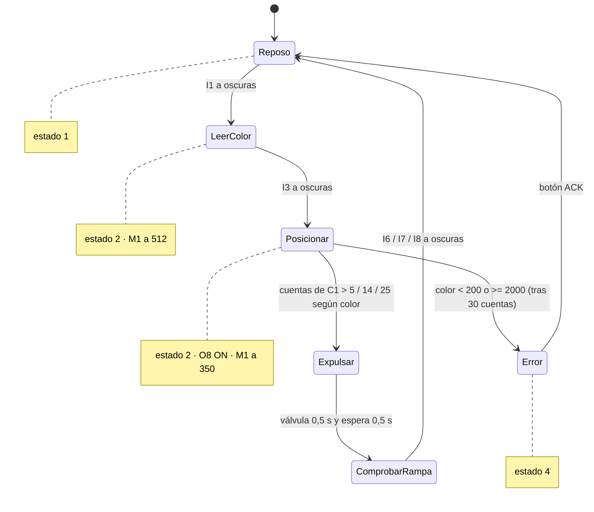

# SLD — Cinta clasificadora (TXT 5)

> Estación elegida para la prueba de concepto: [[F0 - Prueba de concepto SLD]]. Es autocontenida, tiene un flujo claro y usa casi todos los tipos de componente.

## Qué hace
Recibe la pieza que sale de la cinta del [[MPO - Horno y mesa giratoria]], **lee su color** mientras avanza, la lleva hasta los cilindros y la **expulsa a la rampa de su color**. Después el [[VGR - Robot de vacío]] la recoge de la rampa.

## E/S

Tabla en el inventario (fuente única, no se duplica aquí):

![[Inventario de E-S#SLD – Clasificadora (TXT 5)]]

## Lógica (`vscode/lib/SLD.py`, función `thread_SLD`)
Bucle infinito, cada 0,5 s:
1. Si `I1` (barrera de entrada) está a oscuras → hay pieza → estado 2 (clasificando).
2. Arranca la cinta (`M1` a 512) y, **mientras `I3` no detecte la pieza**, lee el [[Sensor de color]] `I2` y se queda con el **valor mínimo** (cuanto más clara la pieza, menos tensión).
3. Para la cinta y enciende el compresor `O8`.
4. Arranca la cinta a 350 y **cuenta pulsos** del final de carrera `C1` comparando su estado con el anterior (ver [[Contador por pulsos]]).
5. Según el color, para al llegar a cierto número de pulsos y expulsa:

| Color | Rango de tensión | Para tras… | Válvula | Barrera de rampa |
|---|---|---|---|---|
| Blanco | 200 ≤ v < 1150 | >5 pulsos | `O5` | `I6` |
| Rojo | 1150 ≤ v < umbral rojo/azul | >14 pulsos | `O6` | `I7` |
| Azul | umbral ≤ v < 2000 | >25 pulsos | `O7` | `I8` |
| Fuera de rango | <200 o ≥2000 | — | — | → error SLD (estado 4) |

6. `eject*()`: válvula ON 0,5 s → OFF → compresor OFF → espera 0,5 s → comprueba que la barrera de la rampa ve la pieza (OK = 1, si no error = 4).

### Detalles curiosos (útiles para la memoria)
- **Umbral rojo/azul inconsistente:** `thread_SLD` arranca con 1400; `set_calib_data_SLD` lo cambia a **1460** (la lectura desde el JSON está comentada); y `data/FactoryCalibDefault.json` dice **1600**, pero no se usa.
- **Sin timeout:** `while not isEjectionTriggered()` espera para siempre si la pieza no llega a `I3`. Buen caso para la inyección de fallos (F4).
- El estado se publica a la nube (`SLD_MQTT.py`) y al gemelo (`Digital_Twin.py`: `dt/sld/belt`, `dt/sld/cylinder`). Ver [[Contrato MQTT]].

## Diagrama de estados

Entregable de F0.1 en [[F0 - Prueba de concepto SLD]].

### Dos niveles
- **Estado oficial**, el que se publica (`_set_state_SLD`, `state_code`): 1 = reposo, 2 = clasificando, 4 = error.
- **Fases internas**: `LeerColor`, `Posicionar`, `Expulsar` y `ComprobarRampa`. No se publican. Las cuatro van dentro del estado oficial 2.

### Cuándo se comprueba el rango de color
El rango no se comprueba al leer el color. Se comprueba al final del posicionamiento. Con un color fuera de rango, el bucle `while counter <= 29` cuenta 30 pulsos de `C1` sin expulsar nada. Solo al salir del bucle mira si el valor es `< 200` o `>= 2000` y marca el error (`set_factory_error_state('SLD')`).

### El código hace algo distinto de lo que parece (útil para la memoria y para F4)
1. **El error de rampa nunca se publica.** En `ejectWhite`, `ejectRed` y `ejectBlue`, si la barrera de la rampa no ve la pieza, el código pone `state_code = 4`. Pero `thread_SLD` llama justo después a `_set_state_SLD(1, 0)` (línea 125), y eso lo sobrescribe con 1. Además, `eject*` cambia `state_code` directamente, sin pasar por `_set_state_SLD`, así que no fuerza una publicación inmediata. Solo podría verse si la publicación periódica de cada 10 s (`thread_update_SLD`) cayera justo en ese instante.
2. **El motor puede quedarse en marcha.** Con un color fuera de rango, el bucle de posicionamiento cae siempre en `else: pass`. Nadie en `SLD.py` llama a `stop()` de `M1`, así que la cinta sigue a 350 al pasar a error. ⏳ Falta comprobar si otro módulo lo para al entrar en error.
3. **El compresor puede quedarse encendido.** `thread_SLD` enciende `O8` antes de posicionar (línea 79). Solo lo apagan `ejectWhite`, `ejectRed` y `ejectBlue`. Con un color fuera de rango no se llama a ninguna `eject*`, así que `O8` sigue encendido al pasar a error. En `vscode/` ningún otro módulo usa `O8`.

### Decisión de diseño: dónde se detecta la rampa equivocada
La detección de "pieza en la rampa equivocada" va en la **planta virtual (Unity)**, no en la [[Librería fischertechnik virtual]]. La librería imita los bornes y no conoce el color real de la pieza. La planta sí lo conoce.

## En Unity hoy
- `ControladorCintaSLD_mqtt.cs`: mueve los eslabones de la cinta según `dt/sld/belt`, **pinta** la pieza del color que dice el cilindro, la traslada a su rampa y genera una pieza de repuesto si "debería haber una".
- `ControladorCilindrosSLD_mqtt.cs`: mueve los pistones y crea o destruye piezas en las rampas. El [[VGR - Robot de vacío]] lee sus propiedades (`IsWhiteSensorActivo`, `spawnPoint*`).
- Ambos son **marionetas**: ver [[Marioneta vs planta]].
- En `PlantaVirtual.unity` los dos están desactivados ([[D007 Quién mueve la escena]]).

### Posiciones en la escena (leídas el 2026-11-06, sin corregir)
Son datos de partida para F0.6. **Los valores mecánicos los decide Mario.** Están en metros y en coordenadas del mundo, y salen del editor (`transform.position` y el centro de las mallas, `Renderer.bounds`).
- El padre `LearningFactory_modelo3D` tiene **escala 100** y está en (1.3765, 0, 1.4283). La SLD está **girada 180° sobre Y**, con su raíz en (1.1034, 0.1037, 2.6653).
- **El pivote no marca dónde está la pieza:** en el modelo CAD, el cilindro rojo y el azul comparten pivote, igual que dos de los sensores. Para situar algo, usa el centro de la malla.

| Objeto | Pivote (x, y, z) | Centro de la malla (x, y, z) | Tamaño (x, y, z) |
|---|---|---|---|
| Cinta | 1.0027, 0.1068, 2.3261 | 1.0301, 0.1006, 2.5041 | 0.0297, 0.0306, 0.4208 |
| Ejes de la cinta | 1.0302, 0.1078, 2.6921 | 1.0302, 0.1006, 2.5041 | 0.0119, 0.0201, 0.4103 |
| Pulsador C1 | 1.0678, 0.1081, 2.3313 | 1.0650, 0.0931, 2.3223 | 0.0095, 0.0356, 0.0180 |
| Sensor de entrada | 0.9983, 0.1156, 2.5113 | 1.0303, 0.1231, 2.2938 | 0.0654, 0.0150, 0.0150 |
| Sensor de clasificación | 1.0978, 0.1007, 2.5676 | 1.0311, 0.1231, 2.5188 | 0.0711, 0.0151, 0.0150 |
| Cilindro blanco | 1.0753, 0.0856, 2.5263 | 0.9765, 0.1292, 2.5413 | 0.0831, 0.0272, 0.0300 |
| Cilindro rojo | 0.9912, 0.1006, 2.3088 | 0.9765, 0.1287, 2.6014 | 0.0831, 0.0262, 0.0301 |
| Cilindro azul | 0.9912, 0.1006, 2.3088 | 0.9765, 0.1288, 2.6613 | 0.0831, 0.0265, 0.0300 |
| Sensor de pieza blanca en la rampa | 0.9908, 0.0885, 2.3267 | 1.1203, 0.0925, 2.5413 | 0.0150, 0.0161, 0.0729 |
| Sensor de pieza roja en la rampa | 1.1128, 0.1006, 2.6276 | 1.1053, 0.0931, 2.6013 | 0.0150, 0.0151, 0.0729 |
| Sensor de pieza azul en la rampa | 0.9908, 0.0885, 2.3267 | 1.1203, 0.0931, 2.6613 | 0.0150, 0.0150, 0.0729 |
| Final de la rampa blanca | 1.1053, 0.0876, 2.5563 | 1.1203, 0.0852, 2.5413 | 0.0300, 0.0048, 0.0300 |
| Final de la rampa roja | 1.1053, 0.0876, 2.6163 | 1.1203, 0.0852, 2.6013 | 0.0300, 0.0048, 0.0300 |
| Final de la rampa azul | 1.1053, 0.0877, 2.6763 | 1.1203, 0.0853, 2.6613 | 0.0300, 0.0048, 0.0300 |
| Controlador TXT | 1.0903, 0.0756, 2.3763 | 1.1353, 0.0846, 2.3763 | 0.0900, 0.0181, 0.0900 |

## 🔧 Diseño de Mario (planta virtual)
- ❓ ¿Cómo convertir la velocidad del motor (0–512) en velocidad lineal de la cinta (mm/s)?
- ❓ ¿Cuántos pulsos de `C1` hay por mm de cinta? ¿Dónde están físicamente `I1`, `I2`, `I3` y los 3 cilindros, medidos sobre la cinta?
- ❓ ¿Cuánto tarda un cilindro en extenderse? ¿Qué pasa si la válvula se abre sin compresor?
- ❓ ¿Cómo se mueve la pieza sobre la cinta: arrastrada de forma cinemática o con física?
